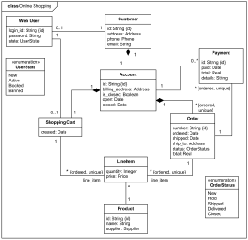

# Cell Society Design Plan
### Team Number
Team 2
### Names
Ixa Sigler, Michael Lei, Emilio Garcia


#### Examples

Here is a graphical look at my design:



made from [a tool that generates UML from existing code](http://staruml.io/).


Here is our amazing UI:


taken from [Brilliant Examples of Sketched UI Wireframes and Mock-Ups](https://onextrapixel.com/40-brilliant-examples-of-sketched-ui-wireframes-and-mock-ups/).


## Overview
The goal of the program is to abstract the concept of a cellular automata so that it can run different configurations and rulesets based on XML input files. The architecture should be open for the initial state of the grid, starting parameters, and logic set; it will be closed for ruleset implementation, graphics, and simulation logic.

## User Interface
We will have the initial screen load a default xml file for a simulation with a dropdown to switch configuration files. There will also be buttons to start the simulation for the current config as well as to pause and speed up and save the current state as a new configuration file. There will also be rules listed at the bottom.

## Configuration File Format
The config files begin with the simulation header with attribute 'type', then some metadata including the config title and author.
The metadata is followed by a grid specifying # rows and columns, then a 'states' element with a row by row setup.
Finally there are starting parameters for variables specific to simulation types.

Example Game of Life file:
```xml
<simulation type="GameOfLife">
  <metadata>
    <title>Glider</title>
    <author>Richard Guy</author>
  </metadata>

  <grid rows="20" cols="20">
    <states>
      0,0,0,0,0
      0,1,0,0,0
      ...
    </states>
  </grid>

  <parameters>

  </parameters>
</simulation>
```

Example Fire simulation file:
```xml
<simulation type="Fire">
  <metadata>
    <title>Dense Forest</title>
    <author>Emilio, Michael, Ixa</author>
  </metadata>

  <grid rows="30" cols="30">
    <states> ... </states>
  </grid>

  <parameters>
    <param name="probCatch" value="0.55"/>
  </parameters>
</simulation>
```

## Design Details

### SimulationDriver
SimulationDriver.java starts, stops, and runs the simulation at a specified framerate. It collaborates with the CellGrid and Renderer to drive their updates
This meets the core start, pause, and speed requirements by controlling when simulation ticks occur (CELL-11, CELL-12, CELL-13).

```java
public class SimulationDriver {
    // tick renderer and grid forward
    private void tick(double elapsedTime);
    
}
```

### CellGrid
CellGrid.java is a data containing class that holds the grid of cells as well as some helper methods when applying game rules. It is used by the SimulationDriver to update all cells after a tick.
Its two-pass update ensures simultaneous state updates and correct edge handling for all core simulations (CELL-01–CELL-06).

```java
public class CellGrid {
    // get neighbors of cell at position (x, y)
    public CellGrid( )
    public List<Cell> getCellNeighbors(int x, int y);
    
    // get one cell
    public Cell getCell(int x, int y);
    
    // iterate through all cells and simulate what their new state *should* be (but don't set it yet)
    public void findNewCellStates();
    
    // iterate through all cells and update their state to next state
    public void updateCellStates();
}
```

### GameRules
Represents a set of game rules. We'd make it an abstract class that every different set of game rules has to extend (e.g., ForestFire.java, Conway.java).
Different rule implementations allow multiple CA types to reuse the same grid and driver while changing only behavior (CELL-01–CELL-05).

| GameRule                                    |      |
|---------------------------------------------|------|
| State getNextState(currentState, neighbors) | Cell |

```java
public abstract class GameRules {
    private Enum stateEnum;
    
    public GameRules(Enum stateEnum) {
        this.stateEnum = stateEnum;
    }
    
    abstract public State getNextState(State currentState, List<Cell> neighbors);}
```

### Cell
Represents a single unit in the simulation that maintains state and is responsible for computing and committing its next state. A `Cell` collaborates with `GameRules` to determine state transitions and with the `Grid` to receive neighbor information.


| Cell Method                     | Collaborates With |
|---------------------------------|-------------------|
| `updateNextState(neighbors)`    | Grid, GameRules   |
| `updateState()`                 | Grid              |
| `getState()`                    | Renderer          |

#### Cell Abstraction

```java
public interface Cell {
  void updateNextState(List<Cell> neighbors);
  void updateState();
  State getState();
}
```
```java
public class BasicCell implements Cell {
  private State currentState;
  private State nextState;
  private GameRule gameRules;

  public BasicCell(State initialState, GameRule rules) {
    this.currentState = initialState;
    this.nextState = initialState;
    this.gameRules = rules;
  }

  @Override
  public void updateNextState(List<Cell> neighbors) {
    nextState = gameRules.getNextState(currentState, neighbors);
  }

  @Override
  public void updateState() {
    currentState = nextState;
  }

  @Override
  public State getState() {
    return currentState;
  }
}

```

### GridView
Manages the rendering of the screen independent of the data structure used by CellGrid. GridView is defined as an interface so different rendering implementations can be swapped without changing simulation, grid, or rule logic.

```java
public interface GridView {
  Node getNode();
  void render(CellGrid grid);
}
```

## Use Cases
* Apply the rules to a middle cell: set the next state of a cell to dead by counting its number of neighbors using the Game of Life rules for a cell in the middle (i.e., with all its neighbors)
    ```java
  List<Cell> neighbors = grid.getCellNeighbors(x, y);
  State next = rules.getNextState(cell.getState(), neighbors);
  cell.updateNextState(neighbors);
    ```
* Apply the rules to an edge cell: set the next state of a cell to live by counting its number of neighbors using the Game of Life rules for a cell on the edge (i.e., with some of its neighbors missing)
   ```java
    // returns < 8 cells, edge detection handled in getCellNeighbors
    List<Cell> neighbors = grid.getCellNeighbors(x, y);
    State next = rules.getNextState(cell.getState(), neighbors);
    cell.updateNextState(neighbors);
    ```
* Move to the next generation: update all cells in a simulation from their current state to their next state and display the result graphically
    ```java
    // First, calculate next state for every cell
    for (int x = 0; x < grid.getWidth(); x++) {
    for (int y = 0; y < grid.getHeight(); y++) {
    Cell cell = grid.getCell(x, y);
    List<Cell> neighbors = grid.getCellNeighbors(x, y);
    cell.updateNextState(neighbors);
    }
    }
    
    // Then, commit all state changes after everyone has decided
    for (int x = 0; x < grid.getWidth(); x++) {
    for (int y = 0; y < grid.getHeight(); y++) {
    grid.getCell(x, y).updateState();
    }
    }
    
    renderer.render(grid);
    ```
* Switch simulations: load a new simulation from a data file, replacing the current running simulation with the newly loaded one
```java
grid.clear();
currentSimulation = simulationFactory.fromConfig(xmlFile);
renderer.render(currentSimulation.getGrid());
```

* Set a simulation parameter:** Set the value of a parameter, probCatch, for a simulation, Fire, based on the value given in a data file.

```java
SimulationConfig config = configLoader.readConfig("fire.xml");

FireRules rules = new FireRules();
rules.setProbCatch(config.getDouble("probCatch"));

Simulation sim = new Simulation(new CellGrid(config), rules);
```

## Design Considerations
### 1. Read-Only Grid Access vs. Full Grid Exposure
One design issue our team discussed at length was how to handle neighbor computation for cells, since different simulations may define “neighbor” differently (e.g., Moore vs. Von Neumann neighborhoods, edge wrapping, or custom interaction ranges).

### Option 1: Separate Grid Classes per Simulation

In this design, each simulation would define its own concrete grid class that overrides the `getCellNeighbors` method.

Examples:
- `LifeGrid` (8-directional neighbors)
- `FireGrid` (4-directional neighbors)
- `ToroidalGrid` (wraparound edges)

**Pros**
- Neighbor logic is explicit and easy to understand per simulation
- Each grid class can be highly optimized for its specific rules
- Clear conceptual mapping between simulation type and grid behavior

**Cons**
- Leads to class explosion as more simulations are added
- Significant code duplication across grid implementations
- Harder to mix and match simulations with different boundary behaviors
- Violates the Open/Closed Principle by requiring new grid classes for each variation

This approach tightly couples simulation behavior to grid implementation, making the system less flexible over time.

---

### Option 2: Single Grid with Configurable Neighbor Strategy (Chosen Approach)

In this design, a single `CellGrid` class is used for all simulations, and the definition of a “neighbor” is controlled by a separate input (e.g., a neighborhood strategy or configuration parameter).

Conceptually:
- `CellGrid` handles storage and bounds checking
- A separate component defines which surrounding cells count as neighbors, 
- GameRules = new FireRules()
- neighbor_offsets=GameRules.NeighborOffsets //[(-1, 0), (1, 0), (0,1), (0,-1)]
- getNeighbors(x, y, neighbor_offsets) //

**Pros**
- Avoids code duplication and class explosion
- Allows reuse of the same grid across multiple simulations
- Enables experimentation by changing neighbor definitions without changing grid code
- Better separation of concerns between spatial layout and simulation rules
- Aligns with the Strategy Pattern

**Cons**
- Slightly more abstract and less immediately intuitive
- Requires additional indirection when determining neighbors

Despite these tradeoffs, this approach provides greater extensibility and maintainability as the system grows.

---

### 2. Read-Only Grid Access vs. Full Grid Exposure

We discussed how much access rendering and external components should have to the grid.

#### Option 1: Expose Full Grid Implementation
Renderers receive a reference to the concrete `CellGrid`.

**Pros**
- Simple to implement
- Maximum flexibility

**Cons**
- Breaks encapsulation
- Risk of accidental state mutation
- Ties renderer to grid implementation

#### Option 2: Read-Only GridView Interface (Chosen)
Renderers depend only on a `GridView` interface that exposes read-only methods.

**Pros**
- Protects simulation state
- Encourages correct usage
- Improves modularity

**Cons**
- Requires maintaining an additional interface
- Slightly more abstract

---
### Design Rationale

We chose to favor a single, reusable `CellGrid` with configurable neighbor behavior to keep the grid abstraction focused solely on spatial organization rather than simulation-specific logic. By externalizing neighbor definitions, we allow simulations to evolve independently from grid storage while minimizing duplicated code and long-term maintenance costs.

Although both approaches are valid, the configurable neighbor strategy better supports future expansion and aligns with our overall goal of decoupling simulation logic from structural concerns.


## Team Responsibilities

 * Team Member #1

 * Team Member #2

 * Team Member #3
