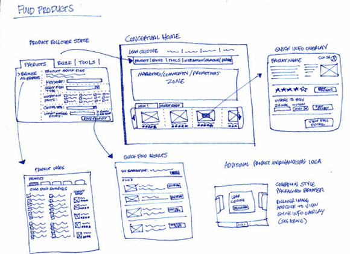
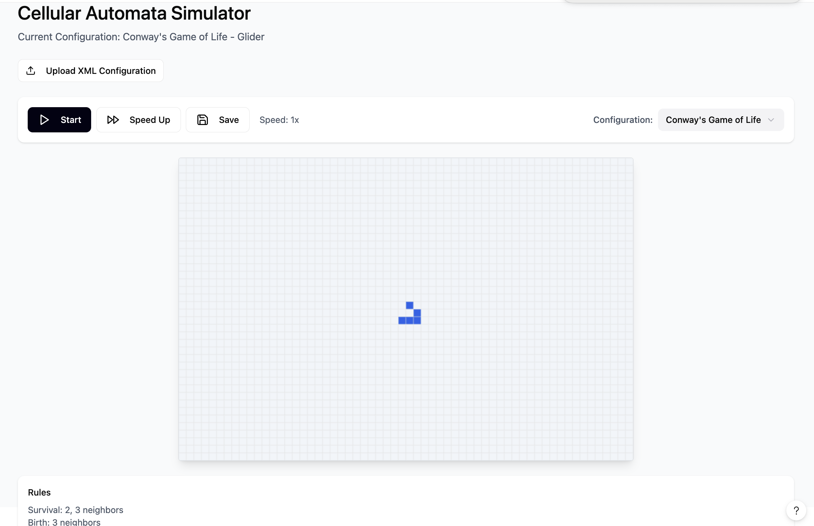

# Cell Society Design Plan

### Team Number
Team 2

### Names
Ixa Sigler, Michael Lei, Emilio Garcia

---

## Introduction

**Problem.** The program must simulate multiple types of Cellular Automata (e.g., Conway’s Game of Life, Percolation, Spreading of Fire, Schelling’s Segregation, Wa-Tor World). Each type has its own states and transition rules; the simulator must support different initial grids, parameters, and simulation types without hard-coding each variant. Users configure and run simulations through files and a graphical interface, and the system must stay maintainable as new simulation types and UI behaviors are added.

**Primary design goals.** The design is most flexible where:

- **Initial state and parameters** — New configurations (grid size, initial cell states, simulation-specific parameters) are added by introducing or editing data files, not by changing code.
- **Simulation logic** — New CA types are added by implementing a small set of well-defined behaviors (rules and optional neighbor policy) and registering them; the rest of the engine stays unchanged.
- **Presentation** — The way the grid is drawn (e.g., Canvas vs. GridPane) is swappable behind an interface so the underlying data and file format are not tied to one UI technology.

**Primary architecture.** The design follows a strict separation between *what* the simulation does and *how* it is shown or configured:

- **Open for extension:** The initial grid layout, parameter values, and the set of simulation types (and their rules) can grow without altering core control flow or rendering. The format of configuration is decoupled so that only a dedicated loader knows whether input is XML or something else.
- **Closed for modification:** The core loop (advance time → compute next states → commit states → notify the UI) and the contract between the simulation engine and the rest of the program stay stable. Rules, grid storage, and the concrete UI widget used for the grid are hidden behind abstractions so their implementations can change without forcing changes elsewhere.

---

## User Interface

**Overall appearance and interaction.** The UI presents a single main window. On launch, a default simulation configuration is loaded and its grid is shown. The main area is a **grid view** where each cell is drawn as a colored rectangle; adjacent cells are adjacent in the layout, and each distinct state has a distinct color (CELL-08). Above or beside the grid, the user sees:

- **Simulation information** — Type, title, author, description, and parameter values are visible or available via an “About” or info panel (CELL-09).
- **Controls** — Buttons or equivalent for: **Load** (CELL-10), **Start** (CELL-11), **Pause** (CELL-12), **Speed** adjustment via slider or buttons (CELL-13), **Save** current state to a configuration file (CELL-14), and **Reset** to initial state (CELL-16, extension).

The user can load a new configuration at any time; the current simulation is stopped and replaced by the new one in its initial state. The window size remains consistent when switching between configurations. While running, the grid view updates in sync with the simulation steps.

**Sketched / reference UI:**



**Target layout / exemplar:**



**Erroneous situations reported to the user.** The program must not crash; it should catch errors and show clear messages (DESIGN-13, DESIGN-14). Situations that must be reported in a user-friendly way include:

- **Bad or missing file** — User selects a file that does not exist, is not readable, or is not a valid configuration file.
- **Invalid or malformed configuration** — The file cannot be parsed (e.g., invalid XML), or required tags/attributes are missing or malformed.
- **Invalid grid dimensions** — Rows/columns are missing, non-positive, or inconsistent with the provided initial state.
- **Invalid or empty initial state** — The state matrix is missing, has wrong dimensions, or uses values that do not match the simulation’s allowed states.
- **Unknown simulation type** — The configuration specifies a simulation type that the program does not support.
- **Invalid parameters** — Simulation-specific parameters (e.g., probCatch) are missing when required, or out of valid range.
- **Save failures** — The user chooses to save but the file cannot be written (e.g., permission or path error).

In all cases, the user should see a concise message (via dialog or status) and be able to continue using the program (e.g., load another file or adjust and retry).

---

## Configuration File Format

Configuration files use XML. The exact schema is decided by the team; the following examples define a consistent style. Tags support: simulation type, title, author, description, grid dimensions, initial cell states (row-by-row), and simulation-specific parameters. State values are numeric and mapped per simulation type (e.g., 0 = DEAD, 1 = ALIVE for Game of Life).

**Example 1: Game of Life**

```xml
<simulation type="GameOfLife">
  <metadata>
    <title>Glider</title>
    <author>Richard Guy</author>
    <description>A glider pattern that moves diagonally across the grid.</description>
  </metadata>

  <grid rows="20" cols="20">
    <states>
      0,0,0,0,0,0,0,0,0,0,0,0,0,0,0,0,0,0,0,0
      0,1,0,0,0,0,0,0,0,0,0,0,0,0,0,0,0,0,0,0
      0,0,1,1,0,0,0,0,0,0,0,0,0,0,0,0,0,0,0,0
      0,1,1,0,0,0,0,0,0,0,0,0,0,0,0,0,0,0,0,0
      0,0,0,0,0,0,0,0,0,0,0,0,0,0,0,0,0,0,0,0
      ...
    </states>
  </grid>

  <parameters>
  </parameters>
</simulation>
```

**Example 2: Spreading of Fire**

```xml
<simulation type="Fire">
  <metadata>
    <title>Dense Forest</title>
    <author>Emilio, Michael, Ixa</author>
    <description>Fire spreading in a dense forest with probCatch 0.55.</description>
  </metadata>

  <grid rows="30" cols="30">
    <states>
      1,1,2,1,1,1,0,1,...
      ...
    </states>
  </grid>

  <parameters>
    <param name="probCatch" value="0.55"/>
  </parameters>
</simulation>
```

(Values for Fire might be, for example: 0 = EMPTY, 1 = TREE, 2 = BURNING. Exact mapping is defined in the rules and optionally in a state-colors or metadata section if the team adds it.)

The team may add attributes or elements (e.g., `stateColors`) as long as the loader interprets them and the rest of the program never depends on XML or tag names directly.

---

## Design Overview

**Abstractions and their roles.** The design introduces five main abstractions, plus a small set of supporting types:

1. **Cell** — Represents one location in the grid. It holds a current state and a pending next state, and can compute the next state given a list of neighbor cells and the active rules. This keeps state transition logic uniform regardless of simulation type.

2. **GameRules** — Encapsulates all transition logic for one simulation type. Given a cell’s current state and its neighbors, it returns the next state. It also describes possible states and their display colors so the UI can render correctly without hard-coding simulation names.

3. **NeighborStrategy** — Defines which offsets from a cell’s position count as neighbors (e.g., Moore vs. Von Neumann, or toroidal wrapping). **GameRules** defines and owns the NeighborStrategy for that simulation type; the grid obtains it from the rules (e.g., via `rules.getNeighborStrategy()`) when computing neighbor lists, so the grid does not store a strategy and “who counts as a neighbor” stays with the rules.

4. **GridView** — Represents the visual representation of the grid. It can be implemented with Canvas, GridPane, or another JavaFX structure. The rest of the UI talks only to this interface, so the choice of widget is local to one implementing class.

5. **State** — Represents a cell state in a way that is uniform across the model (and, if needed, the config). Concrete simulations use their own state sets (e.g., enums or records), but the model and view depend only on this abstraction.

**Collaboration at a high level.** A **Simulation** holds a **CellGrid** and **GameRules**. **GameRules** owns the **NeighborStrategy** for that simulation type. The grid holds **Cell**s and, when stepping, gets the neighbor strategy from the rules to compute each cell’s neighbor list. A **SimulationDriver** advances the simulation at a configured rate and triggers redraws. The **view** holds a **GridView** and a **SimulationController** (or equivalent). The controller reacts to user actions (load, start, pause, speed, save, reset) and talks to a **ConfigLoader** and a **SimulationFactory** to create or replace **Simulation**s. Only the loader reads or writes files; the model and the rest of the view stay independent of file format. The grid is never exposed as a raw 2D array or list of lists; the view receives read-only access (e.g., dimensions and per-cell state) so that the internal data structure can change without affecting rendering or controllers.

**CRC cards.** Each class is summarized by its responsibilities and collaborators. Model classes do not depend on View or Config; View and Config depend on Model. Simulation owns both CellGrid and GameRules and passes rules into the grid on each step.

| **State** | |
|-----------|---|
| **Responsibilities** | Represent a cell state in an immutable, simulation-agnostic way; support equality and display keys. |
| **Collaborators** | Cell, GameRules, SimulationConfig. |

| **Cell** | |
|----------|---|
| **Responsibilities** | Hold current and next state; compute next state from neighbors and rules; commit next state to current. |
| **Collaborators** | GameRules (to get next state), CellGrid (supplies neighbor list). |

| **BasicCell** | |
|---------------|---|
| **Responsibilities** | Implement Cell; store currentState and nextState; delegate transition logic to GameRules. |
| **Collaborators** | GameRules. |

| **NeighborStrategy** | |
|----------------------|---|
| **Responsibilities** | Define which offsets count as neighbors (e.g., Moore vs. Von Neumann); optionally define boundary behavior (e.g., toroidal). |
| **Collaborators** | None (owned and used by GameRules; grid uses it only via rules). |

| **CellGrid** | |
|--------------|---|
| **Responsibilities** | Store rectangular arrangement of cells; compute neighbor list per cell using the strategy supplied by GameRules (`rules.getNeighborStrategy()`); drive two-pass update (compute then commit); expose read-only state/dimensions only (getRows, getCols, getCellState). |
| **Collaborators** | Cell, GameRules (passed in for updateAllCells; grid calls `rules.getNeighborStrategy()` when computing neighbors). |

| **GameRules** | |
|---------------|---|
| **Responsibilities** | Own the NeighborStrategy for this simulation type; compute next state from current state and neighbor cells; declare possible states and state-to-color map for the UI. |
| **Collaborators** | State, Cell (reads neighbor states), NeighborStrategy (owned). Concrete subclasses: ConwayGameOfLifeRules, FireRules, PercolationRules, SegregationRules, WaTorRules. |

| **Simulation** | |
|----------------|---|
| **Responsibilities** | Own grid and rules; advance one generation via step(); expose read-only grid and config for view. |
| **Collaborators** | CellGrid, GameRules, SimulationConfig. |

| **SimulationDriver** | |
|----------------------|---|
| **Responsibilities** | Control run state (start/pause) and speed; drive periodic stepping and notify view to refresh. |
| **Collaborators** | Simulation. |

| **GridView** | |
|--------------|---|
| **Responsibilities** | Expose a Node for display; render grid from read-only dimensions and per-cell state; allow cell-size configuration. |
| **Collaborators** | Read-only grid (e.g., getRows, getCols, getCellState). Implementations: CanvasGridView, GridPaneGridView. |

| **SimulationView** | |
|--------------------|---|
| **Responsibilities** | Assemble main UI (grid + info + controls); update display when simulation steps or is replaced; show error messages. |
| **Collaborators** | GridView, SimulationInfoPanel, ControlPanel, Simulation (read-only). |

| **SimulationInfoPanel** | |
|-------------------------|---|
| **Responsibilities** | Display simulation metadata: type, title, author, description, parameters, state colors (CELL-09). |
| **Collaborators** | SimulationConfig or Simulation (for metadata). |

| **ControlPanel** | |
|------------------|---|
| **Responsibilities** | Provide Load, Start, Pause, Speed, Save, Reset (CELL-10–14, 16); fire events to controller. |
| **Collaborators** | SimulationController (via callbacks or listener). |

| **SimulationController** | |
|--------------------------|---|
| **Responsibilities** | Translate user actions into model operations; load/save via config; start/pause/speed via driver; show errors in view. |
| **Collaborators** | SimulationDriver, SimulationView, ConfigLoader, SimulationFactory. |

| **ConfigLoader** | |
|------------------|---|
| **Responsibilities** | Parse configuration from file into SimulationConfig; write SimulationConfig to file. Only place that knows file format (e.g., XML). Throw ConfigException on parse/validation failure. |
| **Collaborators** | SimulationConfig, File. |

| **SimulationConfig** | |
|----------------------|---|
| **Responsibilities** | Hold immutable configuration: simulation type, metadata, dimensions, initial state, parameters (CELL-07). |
| **Collaborators** | State (for initial layout). Used by ConfigLoader, SimulationFactory. |

| **SimulationFactory** | |
|-----------------------|---|
| **Responsibilities** | Build Simulation from SimulationConfig: construct GameRules (each subtype is created with the appropriate NeighborStrategy), construct CellGrid (no strategy—grid gets it from rules during updateAllCells), wire and return Simulation. Throw SimulationException for unknown type or invalid config. |
| **Collaborators** | SimulationConfig, Simulation, CellGrid, GameRules, NeighborStrategy (used when constructing GameRules). |

---

## Design Details

Each abstraction is described below, with responsibilities, collaborations, and how it satisfies encapsulation (no leaked grid structure, no XML outside the loader, no dependence on a specific grid UI widget).

---

### State

- **Purpose:** Represents a cell state in an immutable, simulation-agnostic way so that cells, rules, and configuration can exchange state information without depending on a concrete enum or class.
- **Functionality:** Used by Cell, GameRules, and (through config) the loader. Supports equality and, if needed, display keys for the view.
- **Collaborations:** Cells expose and accept State; GameRules consume and produce State; SimulationConfig carries initial state data as State or an equivalent representation.
- **Encapsulation:** The concrete type (e.g., enum or record) is an implementation detail; the rest of the program depends only on the State abstraction.

---

### Cell (interface) and BasicCell

- **Purpose:** One cell in the grid: holds current and next state, and computes the next state from neighbors and rules.
- **Functionality:** Implements the two-pass update (compute all next states, then commit) so that every cell advances based on the same “generation” of neighbor states (supports CELL-01–CELL-06).
- **Collaborations:** The grid supplies neighbor cells and the rules object; the cell calls rules to get the next state and stores it until commit. The view never receives Cell references; it receives state via the grid’s read-only API.
- **Key methods (conceptual):**  
  - `void updateNextState(List<Cell> neighbors, GameRules rules)`  
  - `void commitState()`  
  - `State getState()`
- **Encapsulation:** The grid is not exposed. The view gets state through something like `getCellState(row, col)` on the grid or on a read-only view of the grid, not via `getGrid()` or direct Cell access.

---

### NeighborStrategy (interface)

- **Purpose:** Defines how neighbors are determined (e.g., offsets for Moore vs. Von Neumann, and whether indices wrap).
- **Functionality:** Implementations (e.g., MooreNeighborStrategy, VonNeumannNeighborStrategy) provide offsets or logic used to build the neighbor list for each cell. The grid does not own a strategy; it obtains one from GameRules when needed.
- **Collaborations:** **GameRules** owns a NeighborStrategy and exposes it via `getNeighborStrategy()`. The grid calls `rules.getNeighborStrategy()` inside `updateAllCells(rules)` when computing neighbors. This keeps “what is a neighbor” defined by the rules for that simulation type.
- **Encapsulation:** Keeps “what is a neighbor” out of the grid’s storage logic and out of the file format; only the rules and the strategy implementations care about offsets and bounds.

---

### CellGrid

- **Purpose:** Stores the rectangular arrangement of cells, applies neighbor logic using the strategy supplied by GameRules, and drives the two-pass update using GameRules.
- **Functionality:** Supports stepping the simulation (compute next state for all cells, then commit), and provides read-only access for the view (dimensions and per-cell state). Does not expose the internal data structure. The grid does **not** store a NeighborStrategy; it receives GameRules in `updateAllCells(rules)` and uses `rules.getNeighborStrategy()` when building the neighbor list for each cell.
- **Collaborations:** Owns Cell objects. Uses GameRules during update—both for transition logic (passed to each cell) and for neighbor definition (calls `rules.getNeighborStrategy()` when computing neighbors). Used by Simulation and by the view only through a read-only contract (e.g., `int getRows()`, `int getCols()`, `State getCellState(int row, int col)`). No `getGrid()` or `Object[][]`-style API.
- **Key methods (conceptual):**  
  - `List<Cell> getCellNeighbors(int row, int col, GameRules rules)` or, internally, use `rules.getNeighborStrategy()` when iterating in `updateAllCells(rules)`  
  - `void updateAllCells(GameRules rules)`  
  - `void commitAllStates()`  
  - `int getRows()`, `int getCols()`, `State getCellState(int row, int col)`  
  - `void initializeGrid(...)` (or equivalent, used at load/reset)
- **Encapsulation:** The internal representation (e.g., `List<List<Cell>>` or array) is private. All external access is by coordinates and State, so the data structure can be changed without affecting callers. The grid does not hold a reference to NeighborStrategy; it gets it from the rules so the rules remain the single place that defines neighbor semantics.

---

### GameRules (abstract class) and concrete rule classes

- **Purpose:** Encodes state-transition logic and **neighbor semantics** for one simulation type. Subclasses implement the exact rules for Game of Life, Fire, Percolation, Segregation, Wa-Tor, etc., and each defines the NeighborStrategy for that type (e.g., Life = Moore, Fire = Von Neumann).
- **Functionality:** Implements CELL-01–CELL-05 by defining `getNextState(currentState, neighbors)`. Owns and exposes `getNeighborStrategy()` so the grid can compute neighbor lists without storing a strategy. May also provide possible states and state-to-color mappings for the UI (CELL-08, CELL-09).
- **Collaborations:** Used by Cell (for next state) and by CellGrid (for both transition logic and neighbor strategy). Holds simulation parameters (e.g., probCatch) and a **NeighborStrategy**; the grid obtains the strategy via `getNeighborStrategy()` during `updateAllCells(rules)`.
- **Key methods (conceptual):**  
  - `State getNextState(State currentState, List<Cell> neighbors)`  
  - `NeighborStrategy getNeighborStrategy()`  
  - `List<State> getPossibleStates()`  
  - `Map<String, String> getStateColors()` (or equivalent for the view)
- **Encapsulation:** The view uses only the abstract GameRules interface (or a separate “display” interface) for colors and state names; it does not depend on XML or on which concrete rule class is used. Neighbor definition lives in the rules, so adding a new simulation type means adding a new GameRules subclass that supplies the right strategy—the grid stays unchanged.

---

### Simulation

- **Purpose:** Bundles one CellGrid, one GameRules, and optional SimulationConfig into a single runnable unit. Represents “the current simulation” as seen by the driver and the rest of the app.
- **Functionality:** Offers `step()` to advance one generation, and read-only access to the grid and config so the view can render and show metadata (CELL-08, CELL-09).
- **Collaborations:** Created by SimulationFactory from SimulationConfig. Used by SimulationDriver to step and by the view to display. Never touches files or UI classes.
- **Encapsulation:** Exposes the grid only through a read-only API (e.g., `getGrid()` returns an interface or type that supports only `getRows()`, `getCols()`, `getCellState(row, col)`), not the concrete grid structure.

---

### SimulationDriver

- **Purpose:** Controls running state (start/pause) and speed, and drives periodic stepping and view updates (CELL-11, CELL-12, CELL-13).
- **Functionality:** Start/pause/setSpeed and a tick/step callback that advances the Simulation and triggers a redraw. May use an animation timeline or timer; that detail stays inside the driver or the view, not in the model.
- **Collaborations:** Holds the current Simulation (or a reference to it). Invoked by the controller when the user presses Start, Pause, or changes speed. Notifies or hooks into the view to refresh the grid display after each step.
- **Encapsulation:** The driver does not know about XML or file layout; it only knows about Simulation and stepping.

---

### GridView (interface) and implementations (e.g., CanvasGridView, GridPaneGridView)

- **Purpose:** Renders the grid so that adjacent cells are adjacent on screen and states map to colors. Hides whether the implementation uses Canvas, GridPane, or another JavaFX node (DESIGN-10).
- **Functionality:** Satisfies CELL-08. Draws based on dimensions and per-cell state (e.g., `getRows()`, `getCols()`, `getCellState(row, col)`). Colors come from rules or config (e.g., `getStateColors()`), not from hard-coded simulation names.
- **Collaborations:** Gets data from the Simulation’s grid through the read-only API only. The main view holds a GridView and calls `render(grid)` after each step or when the simulation is (re)loaded. The grid parameter type is the read-only view of the grid, not a concrete internal structure.
- **Key methods (conceptual):**  
  - `Node getNode()`  
  - `void render(<read-only grid type> grid)`  
  - `void setCellSize(double size)` (if needed)
- **Encapsulation:** The rest of the UI does not know or care whether the implementation uses Canvas, GridPane, or something else; it only uses the GridView interface.

---

### SimulationView, SimulationInfoPanel, ControlPanel

- **Purpose:** SimulationView is the main UI container. SimulationInfoPanel shows type, title, author, description, parameters (CELL-09). ControlPanel provides Load, Start, Pause, Speed, Save, Reset (CELL-10–CELL-14, CELL-16).
- **Functionality:** Assemble the grid (via GridView), controls, and info into one window. Update the grid and info when the simulation or config changes. Report errors to the user via dialogs or messages.
- **Collaborations:** SimulationView owns GridView and the panels, and receives updates from the controller (or from the driver) when the simulation steps or is replaced. All JavaFX dependencies stay in this package.
- **Encapsulation:** The choice of panel implementation (e.g., VBox, BorderPane) is internal; the controller only triggers high-level actions (load, start, pause, etc.).

---

### SimulationController

- **Purpose:** Translates user actions (button clicks, file choice, slider changes) into calls on ConfigLoader, SimulationFactory, and SimulationDriver. Keeps view and model decoupled (DESIGN-09).
- **Functionality:** Handles Load (choose file → load → create simulation → show), Start/Pause/Speed (driver), Save (current state → config → loader.write), Reset (reload initial state from config). Catches exceptions from loader/factory and asks the view to show error messages.
- **Collaborations:** Uses ConfigLoader and SimulationFactory; updates SimulationDriver and the main view (SimulationView). Does not parse XML itself; all file format knowledge stays in ConfigLoader.
- **Encapsulation:** File format is unknown to the controller; it passes File or path and receives SimulationConfig or Simulation (or handles exceptions). The grid is never passed as a raw structure.

---

### ConfigLoader and SimulationConfig

- **Purpose:** ConfigLoader is the only place that knows the configuration format (e.g., XML). It reads files into a SimulationConfig and writes SimulationConfig back to files. SimulationConfig is an immutable description of simulation type, metadata, grid size, initial state, and parameters (DESIGN-10, DESIGN-17).
- **Functionality:** Supports CELL-07 and save/load (CELL-14). Validates structure and required fields; throws a custom exception (e.g., ConfigException) with a clear message on error, so the controller can show it to the user.
- **Collaborations:** Called by the controller. Produces SimulationConfig for SimulationFactory. Never touches the Simulation or the grid directly.
- **Encapsulation:** If the team switches to JSON or another format, only ConfigLoader (and possibly a small number of DTOs) change; model and view stay unchanged.

---

### SimulationFactory

- **Purpose:** Builds a Simulation from a SimulationConfig: constructs GameRules (each subclass is built with the appropriate NeighborStrategy), builds CellGrid (no strategy—the grid gets it from rules during `updateAllCells(rules)`), initializes the grid, and returns a ready-to-run Simulation.
- **Functionality:** Centralizes the “config → simulation” logic so the controller stays simple and the set of simulation types is extended in one place. The factory does not pass NeighborStrategy into the grid; it only constructs GameRules that already own the right strategy.
- **Collaborations:** Uses SimulationConfig only. Creates concrete GameRules (which hold their own NeighborStrategy) and CellGrid; no file or UI types. May throw a custom exception for unknown simulation type or invalid config.
- **Encapsulation:** The factory is the only place that maps simulation-type strings to concrete GameRules (and thus to the right NeighborStrategy); the rest of the program depends on the GameRules abstraction, and the grid obtains neighbor behavior from the rules at step time.

---

### Custom exceptions (e.g., ConfigException, SimulationException)

- **Purpose:** Communicate failures (bad file, unknown type, invalid parameters) without returning null or magic values (DESIGN-14). Allow the controller to show messages and keep the program running (DESIGN-13).
- **Collaborations:** Thrown by ConfigLoader and SimulationFactory; caught in the controller and passed to the view as user-facing messages.

### How method signatures hide implementation choices (DESIGN-10)

- **Grid data structure:** No method returns the grid’s internal representation (e.g., no `Object[][] getGrid()`, no `List<List<Cell>> getCells()`). The view and driver use only `getRows()`, `getCols()`, and `getCellState(int row, int col)` (or a read-only grid interface offering those). Thus the grid could be implemented with a 2D array, a list of lists, or a map keyed by (row,col) without affecting callers.
- **File format:** No class in model or view parses or writes files. The controller calls `ConfigLoader.loadConfig(File)` and `ConfigLoader.saveConfig(SimulationConfig, File)`. Parameters and return types are `File` and `SimulationConfig` (or exceptions). Only ConfigLoader’s implementation knows that the file is XML; switching to another format would require changes only inside ConfigLoader and possibly SimulationConfig’s mapping.
- **OpenJFX grid component:** The view does not refer to Canvas, GridPane, or Group. It holds a `GridView` and calls `getNode()` and `render(grid)`. The type of `grid` in `render(grid)` is the read-only grid abstraction. The concrete class that implements `GridView` (e.g., CanvasGridView or GridPaneGridView) is the only place that chooses and uses a specific JavaFX node; that choice can change without touching simulation logic or the rest of the UI.

---

## Design Considerations

### 1. How to define “neighbors” (NeighborStrategy vs. grid subclasses)

**Issue:** Different simulations use different neighborhoods (e.g., Moore vs. Von Neumann) and boundaries (e.g., toroidal). We had to choose between baking this into grid subclasses or extracting it into a separate strategy.

**Option A: Separate grid subclass per simulation/topology**  
(e.g., LifeGrid, FireGrid, ToroidalGrid.)

- **Pros:** Neighbor logic is local and obvious per class; each grid can be tuned for one case.
- **Cons:** Many almost-identical classes; harder to combine simulation type with boundary type; every new topology or simulation would add or change grid classes (open/closed violation).

**Option B: Single grid + NeighborStrategy owned by GameRules (chosen)**  
One grid implementation; neighbor definition is owned by **GameRules** and exposed via `getNeighborStrategy()`. The grid receives rules in `updateAllCells(rules)` and uses `rules.getNeighborStrategy()` when computing each cell’s neighbors, so the grid does not store a strategy.

- **Pros:** One grid implementation; “who counts as a neighbor” is defined by the rules for that simulation type (e.g., Fire = Von Neumann, Life = Moore), so the factory only constructs the right GameRules; easy to add topologies by adding rule subclasses that supply the right strategy; matches Strategy pattern and keeps the grid independent of neighbor semantics.
- **Cons:** Slightly more indirection (grid must call into rules to get the strategy when stepping).

**Decision:** We use Option B and have GameRules define/own the NeighborStrategy so the grid gets it from the rules—no need to pass a separate strategy reference into the grid at construction or step time beyond the rules already passed to `updateAllCells(rules)`.

---

### 2. How much grid access the view should have (read-only API vs. full grid)

**Issue:** The view must draw the grid without the model depending on JavaFX. We had to decide whether the view gets a reference to the full grid (and possibly its internal structure) or only a read-only slice.

**Option A: View receives the full grid (or its internal structure)**  
Renderers get the concrete grid and could call methods that expose or mutate internals.

- **Pros:** Easiest to implement; flexible.
- **Cons:** Encourages reliance on a specific structure (e.g., 2D array); increases risk of bugs from accidental mutation; ties view to grid implementation (encapsulation and DESIGN-10).

**Option B: View receives only a read-only “grid view” (chosen)**  
The model exposes an interface or facade with only methods like `getRows()`, `getCols()`, `getCellState(row, col)`. No `getGrid()` returning lists or arrays.

- **Pros:** Encapsulates storage; prevents mutation from the view; allows changing grid internals (e.g., to a different container or indexing scheme) without touching the UI.
- **Cons:** Requires defining and maintaining a small read-only contract.

**Decision:** We use Option B. The grid’s internal data structure, file format, and choice of grid UI component are all hidden behind abstractions, as required by the design.

---

## Use Cases

Below we describe how the design supports specific scenarios, then give Java-style pseudocode for each. The first five align with the original plan; the next six are additional (two per team member) to stress extensibility, configuration, and UI behavior.

---

**UC1 – Apply rules to a middle cell (Game of Life)**  
For a cell in the interior with eight neighbors, set its next state to DEAD when it has fewer than two or more than three live neighbors.

```java
List<Cell> neighbors = grid.getCellNeighbors(row, col);
cell.updateNextState(neighbors, rules);
// next state stored inside cell until commit
```

---

**UC2 – Apply rules to an edge cell**  
For a cell on the edge, only in-bounds neighbors are returned (e.g., fewer than eight). The same rule logic applies; edge handling is entirely inside the grid and NeighborStrategy.

```java
List<Cell> neighbors = grid.getCellNeighbors(row, col);  // possibly fewer than 8
cell.updateNextState(neighbors, rules);
```

---

**UC3 – Advance one generation and update the display**  
Compute next state for every cell, commit all states, then redraw. The grid obtains the neighbor strategy from the rules when computing each cell’s neighbors.

```java
grid.updateAllCells(rules);   // grid uses rules.getNeighborStrategy() when computing neighbors
grid.commitAllStates();       // make next state current
view.updateDisplay(simulation);
gridView.render(simulation.getGrid());
```

---

**UC4 – Load a new simulation from a file**  
User chooses a new file. Current simulation is stopped and replaced; the new one is shown in its initial state. Window size stays the same.

```java
driver.pause();
SimulationConfig config = configLoader.loadConfig(selectedFile);
Simulation newSim = simulationFactory.createSimulation(config);
driver.setSimulation(newSim);
view.updateDisplay(newSim);
gridView.render(newSim.getGrid());
```

---

**UC5 – Set simulation parameter from configuration**  
When building a Fire simulation, set probCatch from the config.

```java
SimulationConfig config = configLoader.loadConfig(xmlFile);
// factory uses config.getParameters().get("probCatch") when
// constructing FireRules
Simulation sim = simulationFactory.createSimulation(config);
```

---

**UC6 – User loads an invalid or malformed XML file (Ixa)**  
User selects a file that is not valid XML or that violates the schema. The program should show an error and keep running.

```java
try {
    SimulationConfig config = configLoader.loadConfig(selectedFile);
    Simulation sim = simulationFactory.createSimulation(config);
    driver.setSimulation(sim);
    view.updateDisplay(sim);
} catch (ConfigException e) {
    view.showError(e.getMessage());
    // leave current simulation and UI as-is
}
```

---

**UC7 – User saves the current state and then re-loads it (Ixa)**  
User saves, then loads the same file; the simulation should restore to the exact state at save time (CELL-14).

```java
// Save
SimulationConfig current = simulation.getConfigSnapshot(); // or build from grid + rules
configLoader.saveConfig(current, saveFile);

// Later: Load
SimulationConfig config = configLoader.loadConfig(saveFile);
Simulation restored = simulationFactory.createSimulation(config);
driver.setSimulation(restored);
view.updateDisplay(restored);
```

---

**UC8 – User resets the simulation (Michael)**  
User presses Reset; the simulation returns to its initial state; speed and play/pause state do not change (CELL-16).

```java
SimulationConfig initial = simulation.getInitialConfig();
Simulation resetSim = simulationFactory.createSimulation(initial);
driver.replaceSimulationKeepPlayState(resetSim);  // or: driver.setSimulation(resetSim); keep speed/paused
view.updateDisplay(resetSim);
```

---

**UC9 – User changes simulation speed with a slider (Michael)**  
User moves the speed slider; the rate of stepping updates immediately (CELL-13).

```java
void onSpeedSliderChanged(double newSpeed) {
    driver.setSpeed(newSpeed);
    // driver’s timer/animation rate is updated; no change to model state
}
```

---

**UC10 – Display simulation info in an “About” or info panel (Emilio)**  
When a simulation is loaded, show its type, title, author, description, and parameters (CELL-09).

```java
SimulationConfig config = simulation.getConfig();
infoPanel.setTitle(config.getTitle());
infoPanel.setAuthor(config.getAuthor());
infoPanel.setDescription(config.getDescription());
infoPanel.setParameters(config.getParameters());
infoPanel.setStateColors(rules.getStateColors());
```

---

**UC11 – User pauses and then single-steps (Emilio)**  
User pauses, then triggers one step. One generation is advanced and the grid updates.

```java
driver.pause();
driver.step();  // advance exactly one generation
view.updateDisplay(driver.getSimulation());
```

---

**UC12 – Load a configuration with an unknown simulation type (Emilio)**  
The XML specifies a simulation type that the factory does not support. The program should report this and not crash.

```java
try {
    Simulation sim = simulationFactory.createSimulation(config);
    ...
} catch (SimulationException e) {
    view.showError(e.getMessage());
}
// inside factory: if unknown type -> throw new SimulationException("Unknown type: " + type);
```

---

## Team Responsibilities

- **Ixa Sigler**  
  - **Primary:** Configuration and loading (ConfigLoader, SimulationConfig, XML schema, ConfigException, save/load behavior).  
  - **Secondary:** Integration and testing of load/save and invalid-file behavior; helping define SimulationConfig and exception contracts.

- **Michael Lei**  
  - **Primary:** Model core (Cell, CellGrid, NeighborStrategy, two-pass update) and SimulationDriver (start/pause/speed, tick/step).  
  - **Secondary:** Simulation and SimulationFactory; ensuring the grid exposes only a read-only API and that the driver stays free of JavaFX/XML.

- **Emilio Garcia**  
  - **Primary:** View (SimulationView, GridView, SimulationInfoPanel, ControlPanel) and controller (SimulationController, wiring buttons/slider to driver and loader).  
  - **Secondary:** GameRules abstractions and state-color/display hooks; first concrete rule (e.g., Game of Life) and its tests.

**Rough schedule**

1. **Week 1 – Config and model core**  
   Agree on XML schema and SimulationConfig; implement ConfigLoader (and exceptions). Implement Cell, State, CellGrid, NeighborStrategy, and the two-pass update. No UI yet; drive from tests or a minimal main loop.

2. **Week 2 – Rules and simulation assembly**  
   Implement GameRules and at least one concrete rules (Game of Life). Implement Simulation and SimulationFactory; connect config → simulation in code. Add SimulationDriver and hook it to Simulation.

3. **Week 3 – View and controller**  
   Implement GridView (e.g., Canvas or GridPane), SimulationView, ControlPanel, SimulationInfoPanel, and SimulationController. Wire Load/Start/Pause/Speed/Save/Reset to driver and loader. Implement error dialogs/messages for invalid file and unknown type.

4. **Week 4 – More simulations and polish**  
   Add Fire, Percolation, Segregation, Wa-Tor (as many as required). Add Reset and any extension behaviors. Externalize strings and styles (DESIGN-15). Improve tests (unit + TestFX) and fix design issues found during use-case walkthroughs.

---

